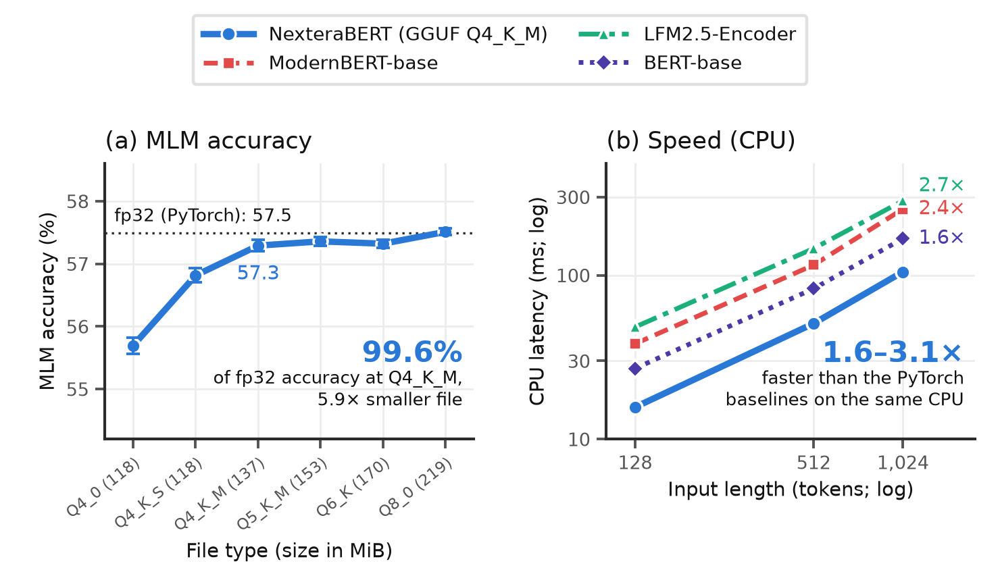

# NexteraBERT.cpp

NexteraBERT.cpp converts, quantizes, and runs [RikkaBotan/NexteraBERT-Mezzoforte-220M-en](https://huggingface.co/RikkaBotan/NexteraBERT-Mezzoforte-220M-en)
on CPUs. It follows the [llama.cpp](https://github.com/ggml-org/llama.cpp) workflow and is built
on its tensor library, [ggml](https://github.com/ggml-org/ggml): a converter writes one
self-contained GGUF file, a quantizer produces the usual file types (Q4_K_M, Q8_0, ...), and a
C/C++ runtime runs them without Python or PyTorch.

Quantized files are at [RikkaBotan/NexteraBERT-Mezzoforte-220M-en-gguf](https://huggingface.co/RikkaBotan/NexteraBERT-Mezzoforte-220M-en-gguf).

The runtime adds three things to ggml:

- **int8 linear layers**: quantized weights are expanded to 8 bits at load time and multiplied
  with AVX-VNNI. Every file type then runs at the same speed.
- **Unpadded batches**: sequences of different lengths share a forward pass, and each result is
  the same as if the sequence were run alone.
- **Blocked attention**: no T × T matrix is built, so 65,536 tokens run in 1.7 GiB of memory.

## Results



(a) Masked-LM accuracy of each GGUF file type on 35,500 masked positions; the dotted line is
the PyTorch fp32 model and the bars give the standard error of the difference from it.
(b) CPU latency of one sequence on a Core Ultra 7 265K: NexteraBERT as GGUF Q4_K_M against
LFM2.5-Encoder, ModernBERT-base, and BERT-base in PyTorch fp32. The figures at the right give
the speed-up at 1,024 tokens.

### Accuracy against the fp32 model

Every file is compared with the PyTorch fp32 model on the same inputs. Token cosine is the
cosine similarity of each token's `last_hidden_state` (60 documents of 16 to 2,048 tokens) and
sentence cosine that of the mean-pooled embedding (2,758 STS-B sentences). MLM accuracy uses
35,500 positions masked at random in 1,000 documents; top-1 agreement is the share of them
where the file predicts the same token as fp32. STS-B is the Spearman correlation of the raw
embeddings with the gold scores. An unquantized f32 GGUF reproduces PyTorch to float rounding
(relative error 1.3e-06).

| File type | Size | Token cosine | Sentence cosine | MLM accuracy | MLM top-1 agreement | STS-B |
|---|---:|---:|---:|---:|---:|---:|
| PyTorch fp32 | 811 MiB | 1 | 1 | 57.49 | 100 | 53.01 |
| Q8_0 | 219 MiB | 0.9995 | 0.9998 | 57.51 | 96.8 | 52.75 |
| Q6_K | 170 MiB | 0.9988 | 0.9994 | 57.32 | 95.2 | 52.71 |
| Q5_K_M | 153 MiB | 0.9979 | 0.9992 | 57.36 | 93.9 | 52.58 |
| **Q4_K_M** | 137 MiB | 0.9951 | 0.9979 | 57.29 | 90.2 | 52.16 |
| Q4_K_S | 118 MiB | 0.9878 | 0.9937 | 56.81 | 85.7 | 51.70 |
| Q4_0 | 118 MiB | 0.9817 | 0.9913 | 55.69 | 82.3 | 53.00 |

### CPU speed against other encoders

Latency of one sequence in milliseconds (median) on an Intel Core Ultra 7 265K. The PyTorch
models run in fp32 with their best of 8, 16, and 20 threads; the GGUF runtime uses its default
18 threads. The fastest is in bold. All quantized file types run at the same speed
(Q8_0 / Q5_K_M / Q4_0: 16.0 / 15.7 / 15.9 ms at 128 tokens).

| Model | Runtime | 128 tokens | 512 tokens | 1,024 tokens |
|---|---|---:|---:|---:|
| NexteraBERT (213M) | GGUF Q4_K_M, NexteraBERT.cpp | **15.7** | **50.8** | **104.9** |
| LFM2.5-Encoder-230M (230M) | PyTorch fp32 | 48.3 | 145.6 | 284.6 |
| ModernBERT-base (149M) | PyTorch fp32 | 38.2 | 115.5 | 253.3 |
| BERT-base (109M) | PyTorch fp32 | 27.0 | 82.8 | 167.3 |
| Speed-up of NexteraBERT GGUF | over LFM2.5 / ModernBERT / BERT | 3.1× / 2.4× / 1.7× | 2.9× / 2.3× / 1.6× | 2.7× / 2.4× / 1.6× |

NexteraBERT as GGUF is 1.6× to 3.1× faster than the three PyTorch models. This compares
a quantized runtime with unquantized PyTorch on the same CPU; it does not rank the
architectures. BERT-base's position table (512) is tiled to reach 1,024 tokens.

<details>
<summary>Long inputs</summary>

| NexteraBERT on CPU | 128 tokens | 1,024 tokens | 8,192 tokens | 65,536 tokens |
|---|---:|---:|---:|---:|
| PyTorch fp32 | 54.6 ms | 300.3 ms | 4.20 s | out of memory |
| **GGUF Q4_K_M** | **15.9 ms** | **105.5 ms** | **1.72 s** | **99.0 s** |
| Speed-up | 3.4× | 2.8× | 2.4× | - |

The runtime never builds a T × T attention matrix, so 65,536 tokens run in 1.7 GiB of memory.
PyTorch on CPU would need about 512 GiB of attention scores at that length and was not run.
NexteraBERT was trained on inputs up to 8,192 tokens; the last column shows that the length
executes, not the output quality there. The PyTorch times are also not the model's reference
speed: its sliding-window blocks use FlexAttention only on CUDA and fall back to dense attention
on CPU.

</details>

## Usage

Tested with MSVC 2022 on Windows 11 (x86-64, AVX2 and AVX-VNNI), CMake 3.31, and Python 3.12.

### Build

```bash
git clone https://github.com/Rikka-Botan/NexteraBERT.cpp
cd NexteraBERT.cpp
cmake -B build
cmake --build build --config Release -j
```

This fetches ggml v0.9.9 and builds `nexterabert-cli`, `nexterabert-quantize`, and the
`nexterabert` shared library into `build/bin`.

### Convert and quantize

Ready-made files can be downloaded from the [model repository](https://huggingface.co/RikkaBotan/NexteraBERT-Mezzoforte-220M-en-gguf) instead.

```bash
pip install numpy safetensors gguf tokenizers huggingface_hub

python python/convert_hf_to_gguf.py RikkaBotan/NexteraBERT-Mezzoforte-220M-en \
    --outfile models/nexterabert-mezzoforte-220m-en-f32.gguf

build/bin/nexterabert-quantize models/nexterabert-mezzoforte-220m-en-f32.gguf \
    models/nexterabert-mezzoforte-220m-en-Q4_K_M.gguf Q4_K_M
```

### Sentence embeddings

```python
import sys; sys.path.insert(0, "python")
from nexterabert_cpp import NexteraBERT

model = NexteraBERT("models/nexterabert-mezzoforte-220m-en-Q4_K_M.gguf")
embeddings = model.encode(["hello world", "a second sentence"])   # (2, 1024), L2-normalized
```

`encode` mean-pools the last hidden states. This is a pretrained encoder, not a
sentence-embedding model: the embeddings are those of the base model without fine-tuning.

### Masked-token prediction

```python
print(model.fill_mask("The capital of France is [MASK].", top_k=3))
```

### Hidden states

```python
ids = model.tokenize(["a short query", "a much longer passage about something else entirely"])
pooled, hidden = model.encode_ids(ids, return_hidden=True)   # hidden[i]: (length_i, 1024)
```

Sequences of different lengths share a forward pass without padding, and each result is the
same as if the sequence were run alone.

### Fine-tuned classifiers

A model fine-tuned with one of the Hugging Face task classes and saved with `save_pretrained`
converts with its head. The task and the label names are read from its `config.json`:

```bash
python python/convert_hf_to_gguf.py path/to/finetuned-model --outfile models/my-classifier-f32.gguf
build/bin/nexterabert-quantize models/my-classifier-f32.gguf models/my-classifier-Q4_K_M.gguf Q4_K_M
```

| Hugging Face class | Python | Result |
|---|---|---|
| `AutoModelForSequenceClassification` | `classify(texts, text_pairs=None)` | `(label, probability)` per text; the raw score for a one-label regression head |
| | `logits(texts, text_pairs=None)` | `(n, n_labels)` logits |
| `AutoModelForMultipleChoice` | `choose(prompt, choices)` | probability of each choice |
| `AutoModelForTokenClassification` | `classify_tokens(text)` | `(token, label, probability)` per token |
| `AutoModelForQuestionAnswering` | `answer(question, context)` | best span of the context and its score |
| `AutoModel` (`pooler_output`) | `pooler_output(ids)` | `(n, 1024)` |

```python
clf = NexteraBERT("models/my-classifier-Q4_K_M.gguf")
print(clf.task, clf.labels)                  # sequence-classification ['negative', 'neutral', 'positive']
print(clf.classify(["a great movie", "a dull one"]))
print(clf.classify("A man is playing a guitar.", "Someone plays an instrument."))   # sentence pair
```

`logits_ids(ids, token_type_ids=None)` is the call underneath all of them: it takes token ids
and returns the logits of the file's head, per sequence or per token. `token_type_ids` are the
segment ids of a model that was fine-tuned with them; the tokenizer does not produce them, so
pass them the way the model was trained. Segment embeddings are stored only when fine-tuning
has moved them from zero, and the pooler only with a head that reads it (`--pooler` keeps it
for `pooler_output` alone; the pooler of the pretrained backbone is untrained).

`python/verify_heads.py` builds a checkpoint for each of the four task classes, converts it,
and compares the logits with PyTorch on sentences, sentence pairs with segment ids, and a
735-token document in one batch. No fine-tuned NexteraBERT is published, so the heads are
randomly initialized: the test covers the arithmetic, not task accuracy. An f32 file
reproduces PyTorch to float rounding.

| Task | Logits compared | f32: max logit difference | Q8_0: logit cosine | Q4_K_M: logit cosine |
|---|---:|---:|---:|---:|
| sequence-classification | 24 | 7.2e-07 | 0.9974 | 0.9833 |
| multiple-choice | 8 | 7.2e-07 | 0.9985 | 0.9962 |
| token-classification | 4,330 | 4.6e-06 | 0.9990 | 0.9940 |
| question-answering | 1,732 | 4.6e-06 | 0.9989 | 0.9933 |

### C API

```c
#include "nexterabert.h"

struct nextera_context * ctx = nextera_load("model-Q4_K_M.gguf", nextera_default_params());
int32_t tokens[]  = { 50281, /* ... */ 50282 };   /* [CLS] ... [SEP] */
int32_t lengths[] = { sizeof(tokens) / sizeof(tokens[0]) };
float   embedding[1024];
nextera_encode(ctx, tokens, lengths, 1, /*hidden*/ NULL, embedding, /*normalize*/ 1);
nextera_free(ctx);
```

`nextera_mlm_logits` returns masked-LM logits for chosen positions, `nextera_classify` the
logits of a classifier head, and `nextera_pooler_output` the pooled vector; see
[`src/nexterabert.h`](src/nexterabert.h).

### Command line

```bash
build/bin/nexterabert-cli -m model.gguf --info
build/bin/nexterabert-cli -m model.gguf --ids 50281,1000,2000,3000,50282
build/bin/nexterabert-cli -m model.gguf --bench 128 --profile
build/bin/nexterabert-cli -m classifier.gguf --ids 50281,1000,2000,3000,50282 --classify
```

The command line takes token ids. The tokenizer is stored in the GGUF file and is rebuilt by
the Python binding.

## File types

| File type | Size | Bits per weight | |
|---|---:|---:|---|
| `Q8_0` | 219 MiB | 8.5 | closest to fp32 |
| `Q6_K` | 170 MiB | 6.6 | |
| `Q5_K_M` | 153 MiB | 5.5, sensitive tensors at Q6_K | |
| `Q4_K_M` | 137 MiB | 4.5, sensitive tensors at Q6_K | recommended 4-bit file |
| `Q4_K_S` | 118 MiB | 4.5 | smallest |
| `Q4_0` | 118 MiB | 4.5, legacy blocks | |

`nexterabert-quantize` also writes `F16`, `Q5_K_S`, `Q5_0`, and `Q3_K_M`, and
`--tensor-type SUBSTRING=TYPE` overrides the type of matching tensors. Only the two-dimensional
weights are quantized; norms, DyT curves, convolution kernels, biases, segment embeddings, and
the classifier's output layer stay f32.

The `_M` files keep at Q6_K the tensors whose 4-bit error reaches the output most directly:
every projection that writes into the residual stream (the mixers' and the MLP's `c_proj`), the
attention value and gate projections, and the MLM head's dense layer. The choice was measured,
not copied from llama.cpp. The dense layers of the pooler and of the per-token classification
heads are kept at Q6_K by analogy with the MLM head's; that was not measured.

<details>
<summary>Sensitivity of each tensor group to 4 bits</summary>

Each group was quantized to Q4_K alone, with everything else in f32. The errors add up to the
error of quantizing everything, so they can be traded individually.

| Tensors at Q4_K (rest f32) | Parameters | 1 − token cosine | Per million parameters | In `_M` |
|---|---:|---:|---:|:---:|
| MLP `c_proj` (down-projection) | 42.5M | 0.00405 | 95e-6 | Q6_K |
| mixer `c_proj` (all 18 layers) | 18.9M | 0.00244 | 129e-6 | Q6_K |
| MLP `c_fc` (up-projection) | 42.5M | 0.00214 | 50e-6 |  |
| attention `c_gate` | 10.5M | 0.00165 | 157e-6 | Q6_K |
| attention `c_v` | 5.2M | 0.00140 | 268e-6 | Q6_K |
| `embedding` | 51.6M | 0.00078 | 15e-6 |  |
| attention `c_k` | 5.2M | 0.00026 | 50e-6 |  |
| SnowLily `x_proj` | 8.4M | 0.00025 | 30e-6 |  |
| attention `c_q` | 10.5M | 0.00021 | 20e-6 |  |
| SnowLily `B_proj` | 8.4M | 0.00018 | 22e-6 |  |
| SnowLily `ltc_conv.*` (low-rank) | 1.6M | 0.00017 | 105e-6 |  |
| HRA `c_C` | 2.1M | 0.00009 | 45e-6 |  |
| HRA `qkv_in`, `qkv_gate` | 4.2M | 0.00006 | 14e-6 |  |
| *everything (Q4_K_S)* | 212.6M | 0.01354 | | |

</details>

## Runtime

| | |
|---|---|
| Graph | ggml graph rebuilt per call; custom operators for RMSNorm, the gates, depthwise convolutions, DyT + RoPE, and HRA pooling |
| Linear layers (quantized files) | int8 GEMM: `s8` weights and `u8` activations with one scale per 256 values, 3 rows × 4 tokens of `vpdpbusd` per 32 inputs |
| Linear layers (f32 / f16 files, non-x86) | `ggml_mul_mat` on the file's own block format |
| Attention | grouped-query, banded for the window blocks, blocked over keys beyond 2,048 tokens |
| Batching | unpadded; convolutions, attention, RoPE positions, and SSSMax lengths are per sequence |
| Threads | ggml thread pool, 90% of the logical cores by default; work is handed out in small items so that fast and slow cores both stay busy |
| Memory | one byte per weight at run time (187 MiB for Q4_K_M, against 134 MiB on disk) |

`--no-int8` (`NexteraBERT(..., int8=False)`) selects ggml's kernels for quantized files. They
are slower on x86 but give Q8_0 a token cosine of 0.9998 instead of 0.9995; for the 4-bit types
the two paths agree. Without AVX-VNNI the int8 path uses `vpmaddubsw` with 7-bit activations.

## Reproducing the results

```bash
pip install torch transformers datasets scipy matplotlib
python python/verify.py   --gguf models/*-f32.gguf models/*-Q8_0.gguf models/*-Q4_K_M.gguf
python python/eval_mlm.py --gguf models/*-Q8_0.gguf models/*-Q4_K_M.gguf --json results/verify_mlm.json
python python/verify_heads.py --types f32 Q8_0 Q4_K_M --json results/verify_heads.json
python python/bench.py    --gguf models/*-Q4_K_M.gguf --extend-positions --lengths 128 512 1024 --batch 1 \
    --baselines google-bert/bert-base-uncased answerdotai/ModernBERT-base LiquidAI/LFM2.5-Encoder-230M
python python/plot_results.py
```

The numbers behind this README are in [`results/`](results).

## Limitations

- CPU only. The int8 path needs x86 with AVX2; other architectures use ggml's kernels and the
  scalar versions of the custom operators, and are untested.
- Built and measured with MSVC on Windows only. GCC and Clang builds are untested.
- The GGUF files do not load in llama.cpp itself.
- Tokenization needs the Python binding; the C API and the command line take token ids.

## Files

- `src/nexterabert.h`, `src/nexterabert.cpp`: the runtime and its C API
- `tools/cli.cpp`, `tools/quantize.cpp`: `nexterabert-cli` and `nexterabert-quantize`
- `python/convert_hf_to_gguf.py`: Hugging Face checkpoint to GGUF
- `python/nexterabert_cpp.py`: Python binding (`ctypes`) with the tokenizer
- `python/verify.py`, `python/eval_mlm.py`, `python/bench.py`: comparison with PyTorch
- `python/verify_heads.py`: pooler and classifier heads against PyTorch
- `python/plot_results.py`: results figure
- `results/`: measurements behind this README
- `assets/summary.png`: results figure

The code is released under the MIT license.

## 🩵 About me 🩵

Japanese independent researcher having shy and pampered personality. Twin-tail hair is a charm point. Interested in nlp. Usually using python and C.

X(Twitter):
https://twitter.com/peony__snow


